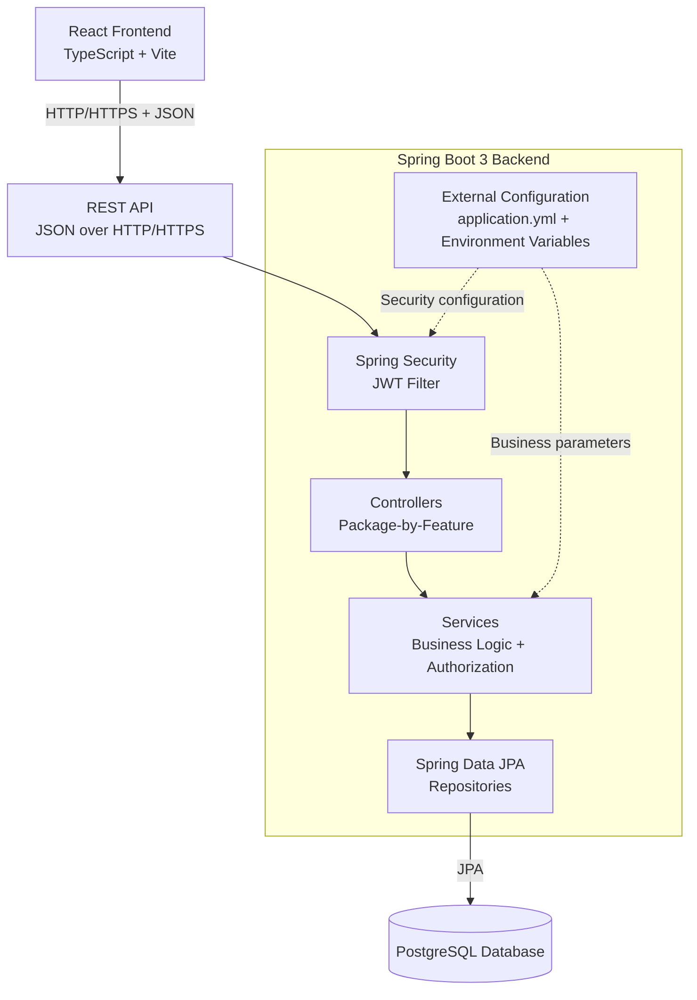
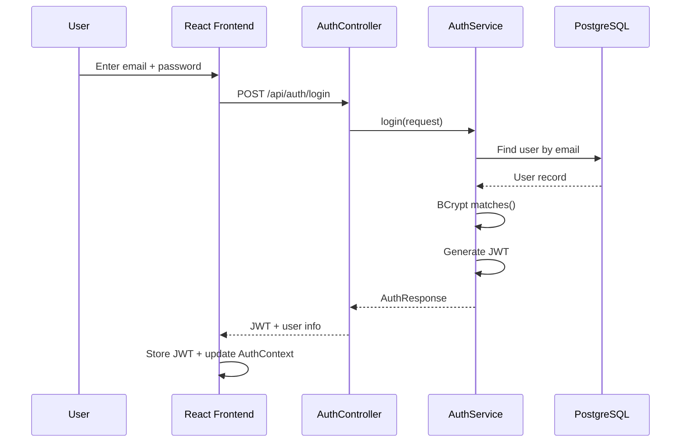
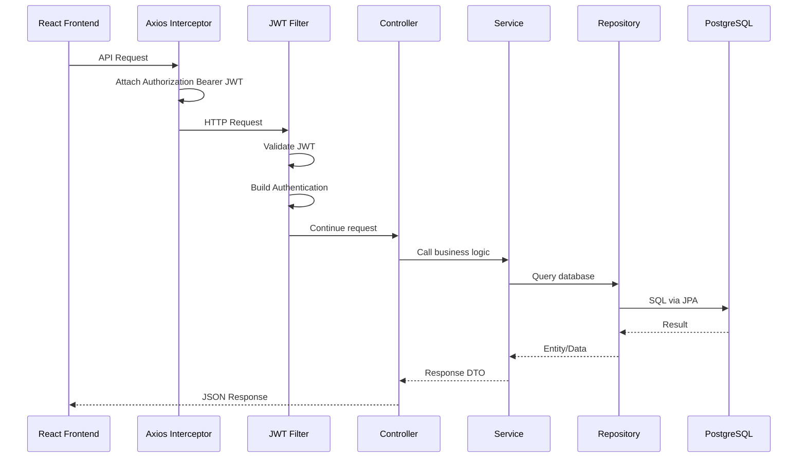

# ARCHITECTURE DESIGN

## Project: Personal Expense Tracker

**Document Version:** 1.1.0  
**Pattern:** Monolithic Layered Architecture + Package-by-Feature  

---

## 1. High-Level Architecture Overview

Hệ thống được thiết kế theo mô hình **Monolithic Layered Architecture**, kết hợp **Package-by-Feature** ở Backend và Frontend.

Kiến trúc phân tách hệ thống thành 3 khu vực chính:

1. **Frontend:** React + TypeScript + Vite
2. **Backend:** Spring Boot REST API
3. **Database:** PostgreSQL

Backend sử dụng các tầng:

* Security
* Controller
* Service
* Repository

Trong đó:

* **Controller** tiếp nhận và trả HTTP request/response.
* **Service** xử lý business logic, authorization và các business rule.
* **Repository** giao tiếp với PostgreSQL thông qua Spring Data JPA.
* **Security Layer** xác thực JWT và thiết lập thông tin user hiện tại.
* **External Configuration** cung cấp các tham số có thể thay đổi mà không cần sửa business logic.

### 1.1 System Architecture



### 1.2 Architecture Principle

Hệ thống tuân thủ nguyên tắc:

```text
Request
   ↓
Security
   ↓
Controller
   ↓
Service
   ↓
Repository
   ↓
Database
```

Không cho phép Controller truy cập trực tiếp Repository để xử lý nghiệp vụ.

Business logic phải được tập trung ở Service để:

* dễ kiểm thử
* dễ debug
* dễ thay đổi
* dễ kiểm soát bởi người phát triển
* tránh duplicate logic giữa các API

---

# 2. Backend Architecture

## 2.1 Package-by-Feature

Backend sử dụng **Package-by-Feature** thay vì tổ chức toàn bộ project theo:

```text
controller/
service/
repository/
entity/
```

Mỗi feature sở hữu các thành phần liên quan của chính feature đó.

Ví dụ:

```text
transaction/
├── Transaction.java
├── TransactionController.java
├── TransactionService.java
├── TransactionRepository.java
├── TransactionRequest.java
├── TransactionResponse.java
└── TransactionType.java
```

Cách tổ chức này giúp xác định nhanh vị trí của một chức năng khi cần sửa hoặc debug.

---

## 2.2 Backend Directory Structure

```text
backend/src/main/java/com/example/expense/

├── auth/
│   ├── AuthController.java
│   ├── AuthService.java
│   ├── LoginRequest.java
│   ├── RegisterRequest.java
│   └── AuthResponse.java
│
├── user/
│   ├── User.java
│   ├── UserController.java
│   ├── UserService.java
│   ├── UserRepository.java
│   └── ChangePasswordRequest.java
│
├── transaction/
│   ├── Transaction.java
│   ├── TransactionType.java
│   ├── TransactionController.java
│   ├── TransactionService.java
│   ├── TransactionRepository.java
│   ├── TransactionRequest.java
│   └── TransactionResponse.java
│
├── category/
│   ├── Category.java
│   ├── CategoryType.java
│   ├── CategoryController.java
│   ├── CategoryService.java
│   └── CategoryRepository.java
│
├── budget/
│   ├── Budget.java
│   ├── BudgetStatus.java
│   ├── BudgetController.java
│   ├── BudgetService.java
│   ├── BudgetRepository.java
│   └── BudgetProperties.java
│
├── dashboard/
│   ├── DashboardController.java
│   ├── DashboardService.java
│   └── DashboardSummaryResponse.java
│
├── report/
│   ├── ReportController.java
│   └── ReportService.java
│
├── config/
│   ├── SecurityConfig.java
│   ├── JwtConfig.java
│   └── JwtAuthenticationFilter.java
│
└── exception/
    ├── GlobalExceptionHandler.java
    ├── ResourceNotFoundException.java
    ├── BusinessException.java
    ├── UnauthorizedException.java
    └── ErrorResponse.java
```

---

# 3. Layer Responsibilities

## 3.1 Security Layer

Security Layer chịu trách nhiệm:

* xác thực JWT
* kiểm tra token hợp lệ
* kiểm tra thời hạn token
* xây dựng Authentication
* đưa thông tin user hiện tại vào Spring Security Context
* phân quyền theo role khi cần
* cấu hình CORS
* cấu hình PasswordEncoder

Security Layer **không xử lý business logic của transaction, budget hoặc report**.

---

## 3.2 Controller Layer

Controller chịu trách nhiệm:

* tiếp nhận HTTP Request
* chuyển JSON Request thành DTO
* kích hoạt Bean Validation thông qua `@Valid`
* lấy thông tin user hiện tại thông qua Spring Security (hoặc `@AuthenticationPrincipal`)
* gọi Service tương ứng
* trả HTTP Response và HTTP Status phù hợp

Ví dụ:

```text
POST /api/transactions

Request
   ↓
TransactionController
   ↓
TransactionService
   ↓
TransactionRepository
```

Controller **không trực tiếp thực hiện các phép tính tài chính hoặc business rule phức tạp**.

Các phép tính như:

```text
Total Income
Total Expense
Balance
Budget Percentage
Budget Status
```

phải thuộc Service.

---

## 3.3 Service Layer

Service là nơi xử lý **core business logic**.

Các trách nhiệm chính:

* kiểm tra business rule
* kiểm tra quyền sở hữu dữ liệu
* chống IDOR
* kiểm tra quan hệ giữa các entity
* tính toán thống kê
* xử lý trạng thái budget
* xử lý transaction database thông qua `@Transactional`
* gọi Repository
* ném các exception nghiệp vụ

Ví dụ với Transaction:

```text
TransactionService

├── validateAmount()
├── validateCategoryType()
├── validateTransactionDate()
├── verifyOwnership()
├── createTransaction()
├── updateTransaction()
├── deleteTransaction()
└── getTransactions()
```

### Business rules được kiểm soát tại Service

```text
Transaction.amount > 0
Transaction.type == Category.type
Transaction.userId == CurrentUser.id
Transaction.date <= Today
Budget belongs to CurrentUser
Category belongs to CurrentUser OR is System Category
```

---

## 3.4 Repository Layer

Repository chịu trách nhiệm giao tiếp với database thông qua Spring Data JPA.

Ví dụ:

```java
public interface TransactionRepository
        extends JpaRepository<Transaction, Long> {
}
```

Có thể định nghĩa các query theo phạm vi user:

```text
findByIdAndUserId(...)
findAllByUserId(...)
findAllByUserIdAndType(...)
findAllByUserIdAndCategoryId(...)
```

Mục tiêu là hạn chế khả năng truy xuất dữ liệu ngoài phạm vi của user.

Tuy nhiên, **Repository query không thay thế business authorization**. Service vẫn phải kiểm soát ownership đối với những operation cần kiểm tra nghiệp vụ.

---

# 4. Frontend Architecture

## 4.1 Feature-based Structure

Frontend cũng sử dụng cách tổ chức theo feature.

```text
frontend/src/

├── assets/

├── components/
│   ├── Navbar.tsx
│   ├── Sidebar.tsx
│   ├── ProtectedRoute.tsx
│   └── StatCard.tsx
│
├── features/
│   ├── auth/
│   │   ├── LoginPage.tsx
│   │   ├── RegisterPage.tsx
│   │   └── authService.ts
│   │
│   ├── dashboard/
│   │   ├── DashboardPage.tsx
│   │   ├── RecentTransactionsCard.tsx
│   │   └── dashboardService.ts
│   │
│   ├── transactions/
│   │   ├── TransactionListPage.tsx
│   │   ├── TransactionFormModal.tsx
│   │   ├── TransactionFilterBar.tsx
│   │   └── transactionService.ts
│   │
│   ├── budget/
│   │   ├── BudgetPage.tsx
│   │   ├── BudgetProgressBar.tsx
│   │   └── budgetService.ts
│   │
│   ├── categories/
│   │   ├── CategoryListPage.tsx
│   │   └── categoryService.ts
│   │
│   └── reports/
│       ├── ReportsPage.tsx
│       ├── CategoryPieChart.tsx
│       ├── MonthlyTrendChart.tsx
│       └── reportService.ts
│
├── services/
│   └── api.ts
│
├── contexts/
│   └── AuthContext.tsx
│
├── types/
│   ├── user.ts
│   ├── transaction.ts
│   ├── category.ts
│   └── budget.ts
│
├── utils/
│   ├── formatCurrency.ts
│   └── formatDate.ts
│
├── App.tsx
└── main.tsx
```

---

# 5. Frontend Responsibilities

## 5.1 Axios API Client

File:

```text
frontend/src/services/api.ts
```

Chịu trách nhiệm:

* cấu hình `baseURL`
* gửi HTTP request
* tự động gắn JWT
* xử lý các response lỗi phổ biến
* cấu hình interceptor

Flow:

```text
React Component
      ↓
Feature Service
      ↓
Axios Instance
      ↓
REST API
```

---

## 5.2 AuthContext

`AuthContext.tsx` quản lý trạng thái authentication của frontend:

```text
authenticated
loading
currentUser
login()
logout()
```

Sau khi login thành công:

```text
JWT
 ↓
AuthContext
 ↓
Frontend authenticated state
```

Logout trong phiên bản MVP:

```text
Remove JWT from client
→ Clear authentication state
→ Redirect to Login
```

JWT không được lưu password.

---

# 6. Security & Authentication Architecture

## 6.1 Authentication Flow



---

## 6.2 Authenticated Request Flow



---

## 6.3 JWT Design

JWT Access Token chứa các claims cần thiết:

```text
userId
username
email
role
iat
exp
```

Algorithm:

```text
HMAC SHA-256 (HS256)
```

Thời gian expiration không hard-code trong Service mà được cấu hình bên ngoài, ví dụ:

```yaml
app:
  jwt:
    expiration-ms: 86400000
```

JWT secret phải được cung cấp thông qua environment variable hoặc secret configuration và **không commit vào Git**.

---

## 6.4 Password Security

Password phải được hash bằng:

```text
BCryptPasswordEncoder
```

Không được:

* lưu plaintext password
* log plaintext password
* trả password/hash về frontend
* commit password hoặc secret vào repository

---

## 6.5 Authorization & IDOR Protection

Mỗi request yêu cầu authentication sẽ xác định:

```text
Current User
```

Service phải kiểm tra ownership trước khi đọc, sửa hoặc xóa resource.

Ví dụ:

```text
GET /api/transactions/15
```

Không được đơn giản:

```text
findById(15)
```

mà phải kiểm soát phạm vi user:

```text
findByIdAndUserId(15, currentUserId)
```

hoặc:

```text
findById(...)
→ verifyOwnership(...)
```

User chỉ được phép:

```text
READ    own resources
CREATE  own resources
UPDATE  own resources
DELETE  own resources
```

System categories có:

```text
user_id = NULL
```

và không được chỉnh sửa/xóa bởi user thông thường.

---

# 7. Externalized Configuration

Các cấu hình có khả năng thay đổi không nên hard-code trong business logic.

Ví dụ:

```yaml
app:
  budget:
    warning-threshold: 0.8

  jwt:
    expiration-ms: 86400000
```

Class:

```text
BudgetProperties.java
```

sử dụng:

```java
@ConfigurationProperties(prefix = "app.budget")
```

Khi thay đổi threshold:

```text
80% → 70%
```

chỉ cần thay đổi configuration:

```yaml
warning-threshold: 0.7
```

không cần sửa `BudgetService`.

JWT secret nên được lấy từ environment variable thay vì ghi trực tiếp vào `application.yml`.

---

# 8. Error Handling Architecture

Toàn bộ exception được xử lý tập trung bằng:

```text
GlobalExceptionHandler
```

sử dụng:

```java
@RestControllerAdvice
```

Response lỗi thống nhất:

```json
{
  "timestamp": "2026-09-29T17:30:00",
  "status": 400,
  "error": "BAD_REQUEST",
  "message": "Số tiền giao dịch phải lớn hơn 0",
  "path": "/api/transactions"
}
```

---

## 8.1 HTTP Status Mapping

### 200 OK

Request thành công.

Ví dụ:

```text
GET /api/transactions
PUT /api/budgets/1
```

### 201 Created

Resource được tạo thành công.

Ví dụ:

```text
POST /api/transactions
POST /api/categories
```

### 400 Bad Request

Request không hợp lệ hoặc vi phạm business rule.

Ví dụ:

```text
amount <= 0
invalid email
invalid month
category type != transaction type
future transaction date
```

### 401 Unauthorized

User chưa authentication hoặc JWT:

```text
missing
invalid
expired
```

### 403 Forbidden

User đã authenticated nhưng không có permission thực hiện operation.

Ví dụ:

```text
ROLE_USER
→ ADMIN-only endpoint
```

### 404 Not Found

Resource không tồn tại hoặc không thuộc phạm vi user hiện tại.

Ví dụ:

```text
GET /api/transactions/999
```

Việc trả `404` cho resource của user khác giúp hạn chế việc tiết lộ resource tồn tại trong hệ thống.

### 500 Internal Server Error

Lỗi hệ thống ngoài dự kiến.

Ví dụ:

```text
Unexpected exception
Database failure
```

Các lỗi này phải được ghi log với stack trace ở server nhưng không trả thông tin nhạy cảm cho client.

---

# 9. Request Validation Flow

Validation được thực hiện ở nhiều lớp.

```text
HTTP Request
    ↓
DTO Validation
    ↓
Controller
    ↓
Service Business Validation
    ↓
Repository
    ↓
Database Constraints
```

Ví dụ `amount`:

### DTO

```java
@NotNull
@Positive
private BigDecimal amount;
```

### Service

Kiểm tra business rule bổ sung nếu cần.

### Database

```sql
CHECK (amount > 0)
```

Mục tiêu là có **defense in depth**:

```text
Frontend validation
        +
Backend DTO validation
        +
Service validation
        +
Database constraint
```

Backend vẫn là lớp bảo vệ chính; frontend validation chỉ nhằm cải thiện user experience.

---

# 10. Transaction Management

Các operation thay đổi dữ liệu sử dụng:

```java
@Transactional
```

Ví dụ:

```text
createTransaction()
updateTransaction()
deleteTransaction()
createOrUpdateBudget()
```

Một operation gồm nhiều bước phải thành công hoặc rollback toàn bộ.

Ví dụ:

```text
Create Transaction
    ↓
Validate Category
    ↓
Validate Ownership
    ↓
Save Transaction
```

Nếu bước cuối thất bại:

```text
Transaction rollback
```

---

# 11. Reporting & Dashboard Architecture

Dashboard và Report không tạo bảng lưu sẵn `balance`.

Balance được tính động:

```text
Balance = Total Income - Total Expense
```

Dashboard Flow:

```text
DashboardController
        ↓
DashboardService
        ↓
TransactionRepository
        ↓
BudgetRepository
        ↓
Database
```

Dashboard trả về:

```text
Total Income
Total Expense
Current Balance
Budget
Spent
Remaining
Percentage
Status
Top 5 Recent Transactions
```

Report Flow:

```text
ReportController
        ↓
ReportService
        ↓
Repository queries
        ↓
Aggregate results
        ↓
Response DTO
        ↓
React Charts
```

Frontend chịu trách nhiệm hiển thị:

```text
Pie Chart
Bar Chart
Monthly Trend
```

Backend chịu trách nhiệm tính toán dữ liệu.

---

# 12. Feature-to-Code Mapping

Một mục tiêu quan trọng của kiến trúc là giúp developer xác định chính xác một feature nằm ở đâu.

## Authentication

```text
Frontend:
features/auth/

Backend:
auth/

Database:
users

Tests:
AuthServiceTest
AuthControllerIntegrationTest
```

## Transaction

```text
Frontend:
features/transactions/

Backend:
transaction/

Database:
transactions

Tests:
TransactionServiceTest
TransactionControllerIntegrationTest
```

## Category

```text
Frontend:
features/categories/

Backend:
category/

Database:
categories
```

## Budget

```text
Frontend:
features/budget/

Backend:
budget/

Database:
budgets
```

## Dashboard

```text
Frontend:
features/dashboard/

Backend:
dashboard/

Data Source:
transactions
budgets
```

## Reports

```text
Frontend:
features/reports/

Backend:
report/

Data Source:
transactions
categories
```

Mapping này được mở rộng chi tiết hơn trong:

```text
docs/FEATURE_MAP.md
```

---

# 13. Testing Architecture

Testing được tổ chức theo nhiều cấp độ.

```text
             ┌─────────────────────┐
             │   Postman API Test   │
             └──────────┬──────────┘
                        ↓
             ┌─────────────────────┐
             │ Integration Testing │
             │ SpringBootTest      │
             │ MockMvc              │
             └──────────┬──────────┘
                        ↓
             ┌─────────────────────┐
             │    Unit Testing     │
             │ JUnit 5 + Mockito   │
             └─────────────────────┘
```

### Unit Test

Tập trung vào:

```text
Service Layer
Business Rules
Boundary Cases
Exception Cases
Authorization Cases
```

### Integration Test

Kiểm tra:

```text
Controller
→ Service
→ Repository
→ Database
```

sử dụng:

```text
@SpringBootTest
MockMvc
```

### API Test

Postman kiểm tra toàn bộ API:

```text
Register
Login
Transactions
Categories
Budget
Dashboard
Reports
Error Cases
Authorization
```

---

# 14. Logging Architecture

Logging sử dụng:

```text
SLF4J
+
Logback
```

### INFO

```text
USER_REGISTERED
USER_LOGIN_SUCCESS
TRANSACTION_CREATED
TRANSACTION_UPDATED
TRANSACTION_DELETED
BUDGET_CREATED
```

### WARN

```text
LOGIN_FAILED
BUDGET_EXCEEDED
INVALID_TRANSACTION
UNAUTHORIZED_RESOURCE_ACCESS
```

### ERROR

```text
DATABASE_ERROR
UNEXPECTED_ERROR
```

Không được log:

```text
password
password hash
JWT token
JWT secret
database password
other credentials
```

---

# 15. Development & Code Control Architecture

Project được phát triển theo workflow:

```text
Requirement
    ↓
Design
    ↓
AI Agent Task
    ↓
Code Generation / Modification
    ↓
Git Diff Review
    ↓
Testing
    ↓
Bug Fix
    ↓
Documentation
    ↓
Commit
```

Không giao cho Agent một task quá lớn như:

```text
"Build the entire application"
```

Thay vào đó, task được chia nhỏ.

Ví dụ:

```text
Implement POST /api/transactions only.

Requirements:
- amount > 0
- category must belong to current user or be system category
- category type must match transaction type
- transaction date cannot be in future
- add service unit tests
```

Sau khi Agent thay đổi code:

```bash
git status
git diff
```

Developer phải kiểm tra:

```text
Which files changed?
Why were they changed?
Any unrelated files?
Any unnecessary dependency?
Any security issue?
Are tests included?
Did existing features break?
```

---

# 16. Definition of Done

Một feature chỉ được xem là hoàn thành khi trải qua toàn bộ quy trình:

```text
Requirement
    ↓
Implementation
    ↓
Git Diff Review
    ↓
Unit / Integration Test
    ↓
Bug Fix
    ↓
Documentation
    ↓
Commit
```

Không xem:

```text
"Agent generated code successfully"
```

là điều kiện đủ để kết luận feature đã hoàn thành.

Feature phải thỏa:

```text
Correctness
+
Testability
+
Security
+
Maintainability
+
Documentation
```

---

# 17. Architecture Constraints

Để giữ project phù hợp với mục tiêu 2–3 tuần, hệ thống **không sử dụng**:

```text
Microservices
Kafka
Redis
Message Queue
Event-driven distributed architecture
Banking API
Payment Gateway
Mobile Application
Real-time WebSocket
AI Financial Advisor
Chatbot
```

Project tập trung vào:

```text
Clean architecture
Correct business logic
Security
Testing
Git workflow
AI Agent control
Documentation
```

Mục tiêu là tạo một hệ thống đủ hoàn chỉnh để chứng minh khả năng **sử dụng AI Agent nhưng vẫn kiểm soát được kiến trúc, code, diff, testing và business logic**.
