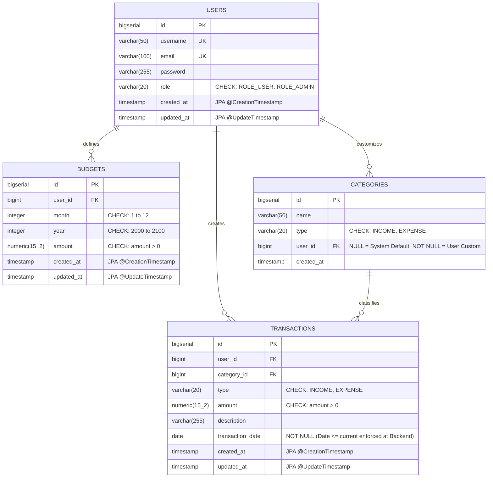

# DATABASE DESIGN SPECIFICATION
## Project: Personal Expense Tracker
**Database Engine:** PostgreSQL 15+ / 16  
**Document Version:** 1.2.0 (Production-Ready Baseline)  

---

## 1. Entity Relationship Diagram (ERD)



---

## 2. Table Schemas & Constraints

### 2.1 Table: `users`
Lưu trữ tài khoản người dùng và quyền truy cập.

| Column | Type | Constraints | Description |
|---|---|---|---|
| `id` | `BIGSERIAL` | `PRIMARY KEY` | Khóa chính tự tăng |
| `username` | `VARCHAR(50)` | `NOT NULL, UNIQUE` | Tên đăng nhập (3–50 ký tự) |
| `email` | `VARCHAR(100)` | `NOT NULL, UNIQUE` | Email đăng nhập |
| `password` | `VARCHAR(255)` | `NOT NULL` | Mật khẩu băm BCrypt |
| `role` | `VARCHAR(20)` | `NOT NULL DEFAULT 'ROLE_USER' CHECK (role IN ('ROLE_USER', 'ROLE_ADMIN'))` | Phân quyền hệ thống |
| `created_at` | `TIMESTAMP` | `NOT NULL DEFAULT CURRENT_TIMESTAMP` | Quản lý bởi JPA `@CreationTimestamp` |
| `updated_at` | `TIMESTAMP` | `NOT NULL DEFAULT CURRENT_TIMESTAMP` | Tự động cập nhật bởi JPA `@UpdateTimestamp` |

---

### 2.2 Table: `categories`
Lưu trữ danh mục thu chi. Phân định ranh giới giữa danh mục hệ thống và danh mục cá nhân qua `user_id`:
* `user_id IS NULL`: Danh mục mặc định hệ thống.
* `user_id IS NOT NULL`: Danh mục cá nhân do người dùng tạo.

| Column | Type | Constraints | Description |
|---|---|---|---|
| `id` | `BIGSERIAL` | `PRIMARY KEY` | Khóa chính tự tăng |
| `name` | `VARCHAR(50)` | `NOT NULL` | Tên danh mục (ví dụ: Ăn uống, Tiền lương) |
| `type` | `VARCHAR(20)` | `NOT NULL CHECK (type IN ('INCOME', 'EXPENSE'))` | Phân loại danh mục |
| `user_id` | `BIGINT` | `NULL, REFERENCES users(id) ON DELETE CASCADE` | Khóa ngoại tới user |
| `created_at` | `TIMESTAMP` | `NOT NULL DEFAULT CURRENT_TIMESTAMP` | Thời gian tạo |

> **Ràng buộc an toàn:** Người dùng chỉ có quyền sửa/xóa các danh mục có `user_id = currentUserId`. Danh mục có `user_id IS NULL` chỉ dành cho ADMIN hoặc hiển thị ở chế độ Read-Only cho User.

---

### 2.3 Table: `transactions`
Lưu trữ các giao dịch tài chính phát sinh hàng ngày.

| Column | Type | Constraints | Description |
|---|---|---|---|
| `id` | `BIGSERIAL` | `PRIMARY KEY` | Khóa chính tự tăng |
| `user_id` | `BIGINT` | `NOT NULL, REFERENCES users(id) ON DELETE CASCADE` | Chủ sở hữu giao dịch |
| `category_id` | `BIGINT` | `NOT NULL, REFERENCES categories(id) ON DELETE RESTRICT` | Danh mục (chặn xóa category nếu đang có giao dịch) |
| `type` | `VARCHAR(20)` | `NOT NULL CHECK (type IN ('INCOME', 'EXPENSE'))` | Phân loại: `INCOME` hoặc `EXPENSE` |
| `amount` | `NUMERIC(15, 2)` | `NOT NULL CHECK (amount > 0)` | Số tiền giao dịch (> 0) |
| `description` | `VARCHAR(255)` | `NULL` | Diễn giải/Ghi chú |
| `transaction_date` | `DATE` | `NOT NULL` | Ngày giao dịch (Quy tắc `<= today` enforce tại Service/DTO) |
| `created_at` | `TIMESTAMP` | `NOT NULL DEFAULT CURRENT_TIMESTAMP` | Quản lý bởi JPA `@CreationTimestamp` |
| `updated_at` | `TIMESTAMP` | `NOT NULL DEFAULT CURRENT_TIMESTAMP` | Tự động cập nhật bởi JPA `@UpdateTimestamp` |

> **Lưu ý kỹ thuật về `transaction_date`:** PostgreSQL không cho phép dùng hàm không bất biến (Non-immutable function như `CURRENT_DATE`) trong CHECK constraint. Do đó, quy tắc `transactionDate <= LocalDate.now()` được kiểm soát chặt chẽ ở DTO (`@PastOrPresent`) và Service layer.

---

### 2.4 Table: `budgets`
Lưu hạn mức chi tiêu hàng tháng của người dùng.

| Column | Type | Constraints | Description |
|---|---|---|---|
| `id` | `BIGSERIAL` | `PRIMARY KEY` | Khóa chính tự tăng |
| `user_id` | `BIGINT` | `NOT NULL, REFERENCES users(id) ON DELETE CASCADE` | Chủ sở hữu ngân sách |
| `month` | `INTEGER` | `NOT NULL CHECK (month BETWEEN 1 AND 12)` | Tháng áp dụng (1 – 12) |
| `year` | `INTEGER` | `NOT NULL CHECK (year BETWEEN 2000 AND 2100)` | Năm áp dụng (2000 – 2100) |
| `amount` | `NUMERIC(15, 2)` | `NOT NULL CHECK (amount > 0)` | Hạn mức ngân sách tối đa |
| `created_at` | `TIMESTAMP` | `NOT NULL DEFAULT CURRENT_TIMESTAMP` | Quản lý bởi JPA `@CreationTimestamp` |
| `updated_at` | `TIMESTAMP` | `NOT NULL DEFAULT CURRENT_TIMESTAMP` | Tự động cập nhật bởi JPA `@UpdateTimestamp` |

> **Ràng buộc duy nhất:** `UNIQUE (user_id, month, year)` đảm bảo một người dùng trong cùng một tháng/năm chỉ có duy nhất 1 bản ghi ngân sách, phục vụ cho cơ chế Upsert.

---

## 3. Data Integrity Matrix (Ma trận toàn vẹn dữ liệu)

Bảng phân định ranh giới trách nhiệm: Quy tắc nào do Database bảo vệ, quy tắc nào do Application (Backend) xử lý. Đây là căn cứ bảo vệ luận điểm lập trình phòng thủ (Defense-in-depth) khi vấn đáp.

| Quy tắc nghiệp vụ (Rule) | Database Layer (PostgreSQL) | Application Layer (Spring Boot) |
|---|---|---|
| **Số tiền > 0** | `CHECK (amount > 0)` | `@Positive` + Service validation |
| **Tháng hợp lệ (1–12)** | `CHECK (month BETWEEN 1 AND 12)` | `@Min(1) @Max(12)` trên DTO |
| **Năm hợp lệ (2000–2100)** | `CHECK (year BETWEEN 2000 AND 2100)` | `@Min(2000) @Max(2100)` trên DTO |
| **Loại giao dịch hợp lệ** | `CHECK (type IN ('INCOME', 'EXPENSE'))` | Java `enum TransactionType` |
| **Loại danh mục hợp lệ** | `CHECK (type IN ('INCOME', 'EXPENSE'))` | Java `enum CategoryType` |
| **Vai trò người dùng** | `CHECK (role IN ('ROLE_USER', 'ROLE_ADMIN'))` | Java `enum Role` |
| **Email duy nhất** | `UNIQUE(email)` | Kiểm tra trùng lặp trong `AuthService` |
| **Username duy nhất** | `UNIQUE(username)` | Kiểm tra trùng lặp trong `AuthService` |
| **Ngân sách duy nhất / tháng** | `UNIQUE(user_id, month, year)` | Cơ chế Upsert trong `BudgetService` |
| **Tự động cập nhật `updated_at`** | Giá trị khởi tạo `DEFAULT CURRENT_TIMESTAMP` | Tự động cập nhật khi Update qua `@UpdateTimestamp` (Hibernate) |
| **Quyền sở hữu (chống IDOR)** | Khóa ngoại `REFERENCES users(id)` | Đối soát `userId` tại `Service.java` trước khi sửa/xóa |
| **Khớp loại Transaction ↔ Category** | Không tạo composite FK phức tạp | Đối soát `transaction.type == category.type` tại `TransactionService` |
| **Không nhập ngày tương lai** | `DATE NOT NULL` (Tránh lỗi non-immutable CHECK) | `@PastOrPresent` tại DTO + kiểm tra `LocalDate.now()` tại Service |
| **Mã hóa mật khẩu an toàn** | Lưu chuỗi hash `VARCHAR(255)` | `BCryptPasswordEncoder` (Salt strength = 10) |

---

## 4. Tối ưu hóa truy vấn qua Index (Chỉ mục)

```sql
-- 1. Tối ưu hóa truy vấn lọc danh sách giao dịch theo ngày và phân trang của từng user
CREATE INDEX idx_transactions_user_date ON transactions(user_id, transaction_date DESC);

-- 2. Tối ưu hóa báo cáo chi tiêu gom nhóm theo danh mục của từng user
CREATE INDEX idx_transactions_user_category ON transactions(user_id, category_id);

-- 3. Tối ưu hóa truy vấn lấy danh mục (danh mục hệ thống + danh mục của chính user)
CREATE INDEX idx_categories_user ON categories(user_id);

-- 4. Tối ưu hóa truy vấn kiểm tra ngân sách tháng hiện tại
CREATE INDEX idx_budgets_user_period ON budgets(user_id, year, month);
```

---

## 5. Dữ liệu khởi tạo mặc định (Initial Seed Data)

```sql
-- Danh mục mặc định cho Chi tiêu (EXPENSE) - user_id IS NULL
INSERT INTO categories (name, type, user_id, created_at) VALUES
('Ăn uống', 'EXPENSE', NULL, NOW()),
('Đi lại', 'EXPENSE', NULL, NOW()),
('Mua sắm', 'EXPENSE', NULL, NOW()),
('Nhà cửa & Hóa đơn', 'EXPENSE', NULL, NOW()),
('Giải trí', 'EXPENSE', NULL, NOW()),
('Y tế & Sức khỏe', 'EXPENSE', NULL, NOW()),
('Khác (Chi tiêu)', 'EXPENSE', NULL, NOW());

-- Danh mục mặc định cho Thu nhập (INCOME) - user_id IS NULL
INSERT INTO categories (name, type, user_id, created_at) VALUES
('Tiền lương', 'INCOME', NULL, NOW()),
('Thưởng', 'INCOME', NULL, NOW()),
('Đầu tư', 'INCOME', NULL, NOW()),
('Thu nhập phụ', 'INCOME', NULL, NOW()),
('Khác (Thu nhập)', 'INCOME', NULL, NOW());
```
